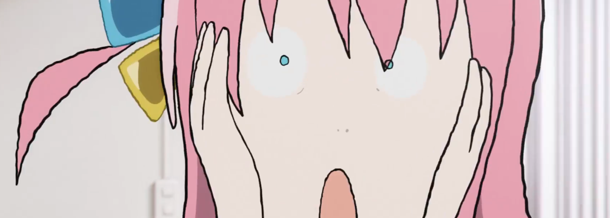

<h1 align="center">hey, i'm yasin (°ロ°)</h1>

  <b>AI engineer in training. I make neural networks do things they were probably not meant to do.</b>

  <a href="https://cheeseburgerhere.github.io/cheeseburgerhere/">blog</a> ·
  <a href="https://github.com/cheeseburgerhere/Resume-Latex/blob/main/Yasin_Yesilyurt_Resume.pdf">résumé</a> ·
  <a href="https://linkedin.com/in/yasin-yesilyurt">linkedin</a> ·
  <a href="mailto:yasinyesilyurt222@gmail.com">email</a>

## now

- studying Artificial Intelligence Engineering at TOBB ETÜ (B.S. expected 2027)
- GNN surrogates for aerodynamics: first author of an accepted RAST 2026 paper on MeshGraphNets for surface-pressure prediction
- fine-tuning and compressing LLMs to run on a single GPU
- 日本語: still loading...

## side quest: Bad Apple!!

I gave a model 16 black frames, took the source away, and made it continue from its own predictions. It drifted, recovered, leaned heavily on learned scene memories, and reconstructed the full 219-second sequence with **5.63% average pixel error**.

**[read: Neural Network Dreams of Bad Apple →](https://cheeseburgerhere.github.io/cheeseburgerhere/bad-apple/)**

## experience

- **Roketsan**, AI research intern: CFD surrogates and physics-informed airfoil generation
- **Beko**, AI engineering intern: multi-agent LLM control and GNN predictive maintenance
- **Teknofest 2025**, technical lead: AI in Health finalist, 5th place

## tools

  

grades and scores

 

- GPA 3.63/4.00
- TOEFL ITP 653/677

